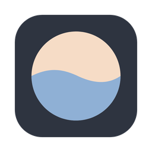
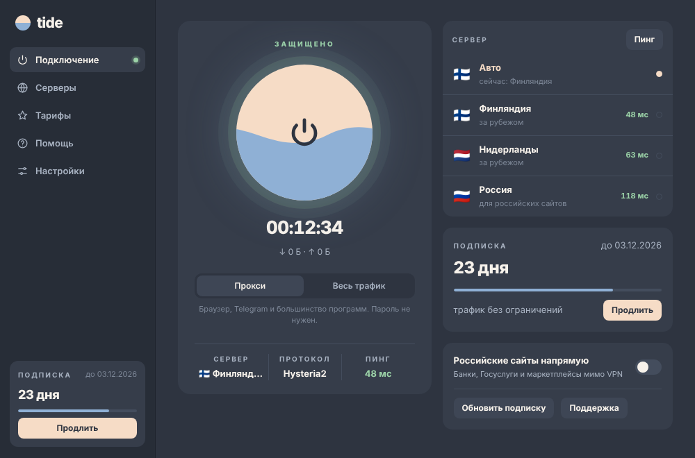
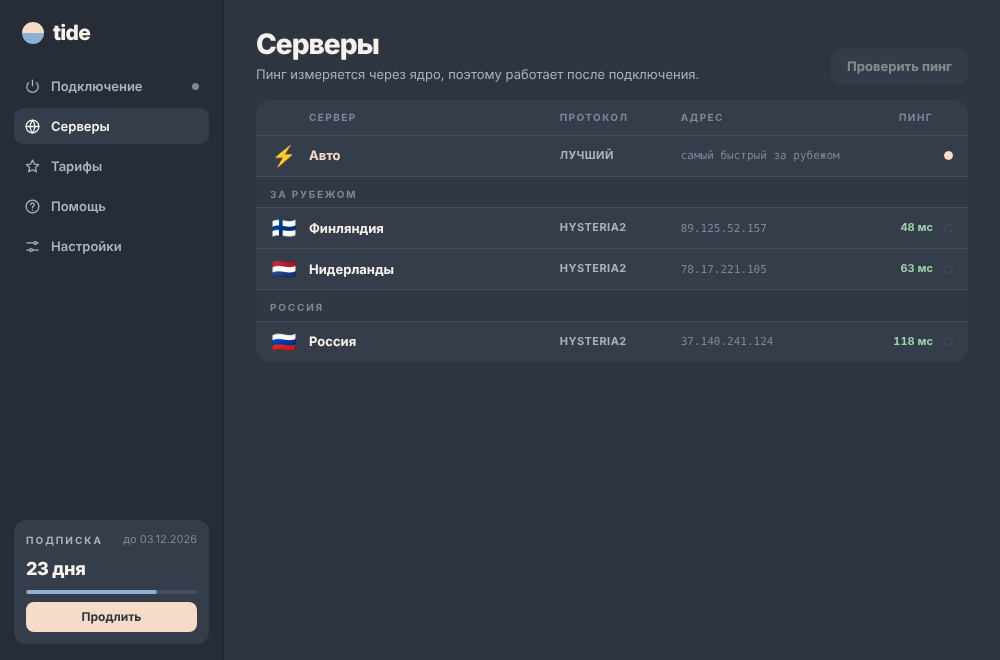

<h1 align="center">tide</h1>

Приложение VPN-сервиса tide для macOS и Windows. Одна кнопка, быстрые серверы в Финляндии, Нидерландах и России.

<b><a href="../../releases/latest">⬇ Скачать последнюю версию</a></b>

## Что умеет
- **Подключение одной кнопкой.** Таймер, трафик, текущий сервер, протокол и пинг всегда на виду.
- **«Авто»** сам выбирает самый быстрый зарубежный сервер. Российский сервер включается вручную, когда нужны сайты, которые работают только в России.
- **Два режима.** «Прокси» работает без пароля и подходит для браузера, Telegram и большинства программ. «Весь трафик» пропускает через VPN всё, включая игры.
- **Российские сайты напрямую.** Банки, Госуслуги и маркетплейсы могут идти мимо VPN.
- **Подписка под рукой.** Видно, сколько дней осталось, продлить можно в боте одной кнопкой.
- Значок в трее, автоподключение при запуске, автообновление подписки.

## Как начать
1. Купите подписку в боте [@roam_vpn_buy_bot](https://t.me/roam_vpn_buy_bot). Он пришлёт ссылку подписки.
2. Скачайте tide со страницы [Releases](../../releases/latest):
   - **Windows:** `tide_…_x64-setup.exe`
   - **Mac с процессором Apple (M1 и новее):** `tide_…_aarch64.dmg`
   - **Mac с процессором Intel:** `tide_…_x64.dmg`
3. Откройте tide, вставьте ссылку подписки и нажмите на большой круг.

### Первый запуск
Приложение пока не подписано платным сертификатом, поэтому система один раз предупредит:
- **Windows:** в окне «Система Windows защитила ваш компьютер» нажмите «Подробнее» → «Выполнить в любом случае».
- **macOS:** если появится «не удаётся проверить разработчика», откройте «Программы», нажмите на tide правой кнопкой → «Открыть» → «Открыть».

## Поддержка
Telegram: [@tidevpn_buy](https://t.me/tidevpn_buy) · канал: [@tide_vpn](https://t.me/tide_vpn)

---

## Для разработчиков
Интерфейс на HTML/CSS/JS (`ui/`), системная часть на Rust и [Tauri 2](https://tauri.app) (`src-tauri/`), ядро — [sing-box](https://github.com/SagerNet/sing-box).

- Собрать на Mac: `bash build-mac.sh`
- Собрать всё через GitHub: вкладка **Actions → build → Run workflow**
- Выпустить версию: **Releases → Draft a new release**, тег вида `v1.0.1` → **Publish**. Установщики для Windows и Mac соберутся и прикрепятся к релизу сами.

Ссылки на бота, поддержку и канал — в начале `ui/app.js`. Тексты тарифов и помощи — в `ui/index.html`.

## Лицензии
Ядро sing-box распространяется по лицензии GPL-3.0, его исходный код: https://github.com/SagerNet/sing-box
